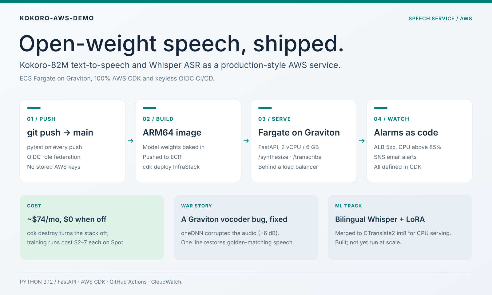
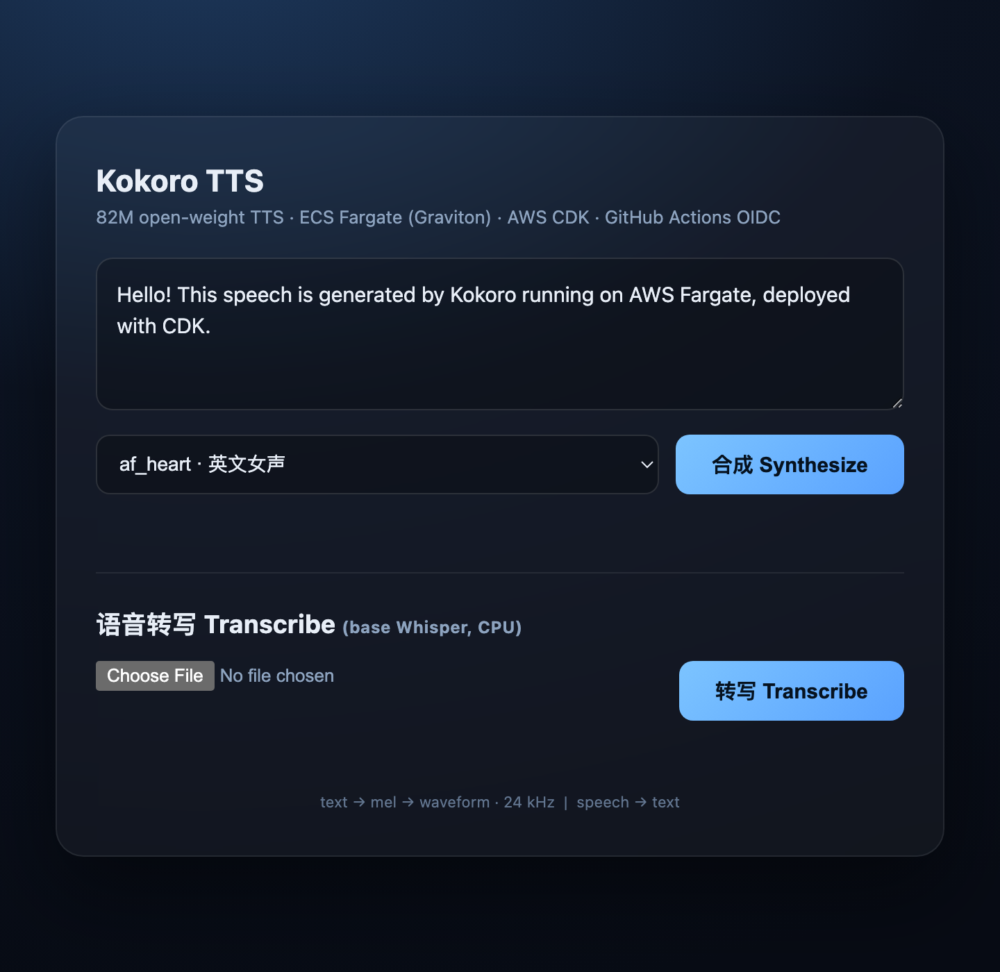
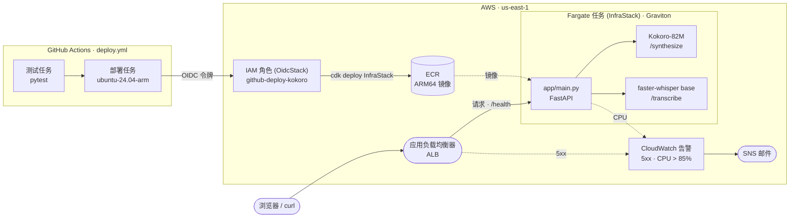
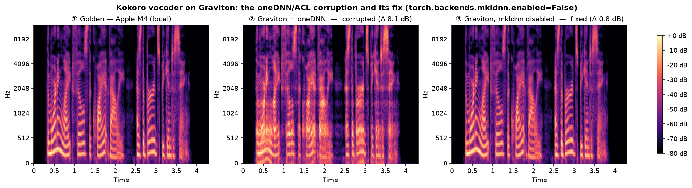
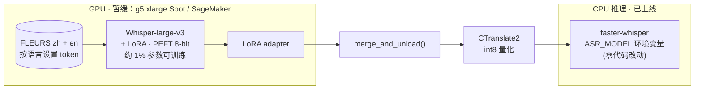
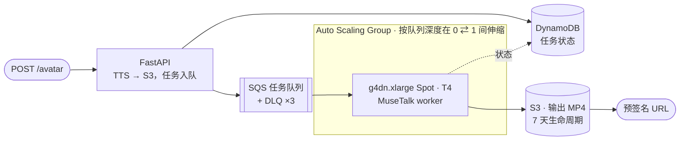

<div align="center">

# Kokoro + Whisper on AWS Fargate

[English](README.md) · **简体中文**

**开源权重的语音 AI（TTS 与 ASR），以生产级服务的形态部署在 AWS 上。**

[](https://github.com/HenryVarro666/kokoro-whisper-fargate/actions/workflows/deploy.yml)


[](https://www.ccao2679.com/projects/#kokoro-whisper-fargate)



</div>

---

<!-- problem-framing:start -->

## 问题与依据

> **部署在 AWS 上的语音服务，能否在部署变更前后保持参考级的音频质量和转写质量，同时满足实测的延迟与运行成本预算？**

**为什么重要：** 端点健康，返回的语音仍可能已经劣化。可部署的语音系统除了可用性、基础设施可复现和成本控制，还需要配套的质量检查。

**核心矛盾：** CPU 推理、模型转换和异步 GPU 任务可以压低运行成本，但也会带来后端差异、冷启动和新的故障路径。本地模型测试既不能证明云端音频与之等价，也不能证明服务的并发承载能力。

[完整的问题陈述与验证计划](PROBLEM.zh.md)

<!-- problem-framing:end -->

## 一览

|  |  |
|---|---|
| **推理服务** | FastAPI 运行在 **ECS Fargate**（ARM64 / Graviton）上，2 vCPU · 6 GB，前置 Application Load Balancer |
| **接口** | `POST /synthesize`（Kokoro-82M TTS）· `POST /transcribe`（Whisper ASR，CPU）· `POST /avatar`（异步，Phase 3） |
| **IaC** | **100% AWS CDK（Python）**：VPC、ECS、ALB、健康检查、CloudWatch 告警、IAM、SQS/DynamoDB/ASG |
| **CI/CD** | **GitHub Actions + OIDC** 角色联合，仓库里没有任何长期有效的 AWS 密钥 |
| **可观测性** | CloudWatch 告警（ALB 5xx · CPU > 85%）→ SNS 邮件，全部以代码定义 |
| **ML 线** *（已搭建，尚未规模化运行）* | Whisper + **LoRA**（PEFT）→ **CTranslate2 int8**，中英双语；通过 `ASR_MODEL` 热替换进 CPU 推理服务 |
| **成本** | 常驻运行 **约 $74/月** · `cdk destroy` → **$0** · 每次 Spot 训练 $2–7 |

---

### 演示

<p align="center"></p>

<p align="center"><sub><em>一个 Fargate 任务，一个页面：输入文字即可听到 24 kHz 语音，上传音频即可得到转写文本。支持中英双语（EN/中文）。</em></sub></p>

## 架构

从 `git push` 到线上可访问的 URL，仓库里始终不存放任何 AWS 密钥：



上面一行是部署路径：push 到 `main` 后，只有 `pytest` 通过且提交信息里没有 `[skip deploy]`，`deploy` 任务才会运行；它用 GitHub OIDC 令牌换取 `OidcStack` 中的角色，再由 `cdk deploy` 把 ARM64 镜像构建并推送到 ECR，滚动更新 Fargate 服务。下面一行是请求路径：ALB 把请求和 `/health` 健康检查转发给同时加载两个模型的 FastAPI 任务；虚线表示镜像拉取和两条告警指标。

### 接口

| 接口 | 模型 | 设备 | 状态 |
|---|---|---|---|
| `POST /synthesize` | Kokoro-82M（开源权重 TTS）→ 24 kHz WAV | CPU（Graviton） | ✅ 已上线 |
| `POST /transcribe` | faster-whisper `base`，int8（语音 → 文本） | CPU（Graviton） | ✅ 已上线 |
| `POST /avatar` + `GET /avatar/{id}` | MuseTalk 数字人口播 → MP4 | GPU（g4dn Spot） | 💤 部署 `AvatarStack` 之前返回 503 |
| `GET /health` | — | — | ✅ ALB 目标健康检查 |

---

## ⚡ 工程实战：Graviton 上的声码器 bug

Kokoro 部署到 Fargate/Graviton 后，输出的语音**明显劣化，听起来像“机器人”**。发现它靠的是耳朵：一段合成音频*听着不对劲*，而不是哪个测试挂了。

**以*黄金*参考为基准排查，而不是拿云端互相比。** 用同一段文本分别在 Graviton 服务上和本地 Apple Silicon（黄金参考）上合成，问题立刻暴露：云端输出**响度低 6 dB，log-mel 频谱距离约 8 dB**，谐波被抹平（图 ②）。



**根因：** PyTorch 在 aarch64 上的 **oneDNN（ACL）CPU 后端**算错了声码器的卷积，在固定版本 `torch==2.12.0` 上**与线程数无关**。早先的绕过办法（`OMP_NUM_THREADS=1`，当时认为罪魁是多线程内核）后来被证明**不够**：单线程的服务*依然*失真（图 ②）。

**修复只需一行：在声码器运行前关闭 oneDNN 后端：**

```python
torch.backends.mkldnn.enabled = False   # app/main.py，位于 get_pipeline() 中
```

修复后音频与黄金参考一致：**频谱距离 0.8 dB，等于两次运行之间的噪声底**（图 ③），而且**不影响延迟**（在 2 vCPU 的 Graviton 任务上端到端 RTF ≈ 1.5，与之前相同）。这一结论经过以黄金参考为基准的频谱 A/B 验证，分别在 Fargate 上和重新部署后的线上服务上进行（与黄金参考相差 0.74 dB）。

> **经验：** (1) 一个“更快”但*听起来*不对的配置，比全绿的测试套件更值得重视；(2) 永远拿**黄金**参考做 A/B，云端对云端的比较曾让这个 bug 明晃晃地藏了起来；(3) 旧的“修复”要重新验证：`torch` 升级之后，`OMP_NUM_THREADS=1` 这个绕过办法已经悄悄失效。

---

## 工程决策与取舍

代码背后的“为什么”：下面每一项都是有意为之，而不是沿用默认值：

| 决策 | 原因 |
|---|---|
| **`torch.backends.mkldnn.enabled=False`** | torch 的 oneDNN（ACL）后端在 Graviton 上会破坏 Kokoro 声码器的输出，且*与线程数无关*（见上文实战）。关闭它即可恢复黄金参考级音频；旧的 `OMP_NUM_THREADS=1` 防护已证明不够。 |
| **不带 NAT 的 VPC**（公有子网） | NAT 网关每月约 $32，是新手最常踩的账单陷阱。任务改用公网 IP 直接拉取镜像。 |
| **用 OIDC，不用访问密钥** | Actions 通过 Web 身份联合扮演一个限定到本仓库的角色，没有需要防泄漏或轮换的长期密钥。 |
| **模型权重打进镜像** | 部署完成即就绪：没有冷启动下载，回滚只需切换镜像标签。 |
| **熔断器 + 自动回滚** | 坏镜像会快速失败并自动回退，而不是卡住约 3 小时；`min 100%` 保证旧任务在新任务健康前继续提供服务。 |
| **对文档和训练目录设置 `paths-ignore`** | 在一次“训练提交触发了生产重新部署”的事故后增加的纵深防御：ML 和文档提交永远不会动到线上服务。 |
| **`/transcribe` 是*同步* def** | faster-whisper 是 CPU 密集的阻塞调用；同步接口会被 FastAPI 放进线程池执行，长任务就不会饿死事件循环、导致 `/health` 卡住（那样 ALB 会杀掉任务）。有回归测试守护。它的 `cpu_threads=2` 单独固定，不受（已成历史遗留的）`OMP_NUM_THREADS=1` 影响。 |
| **可缩容到零的 GPU worker** | Phase 3 的数字人 ASG 空闲时运行 **0** 个实例；只有 SQS 队列里有任务时才拉起一台 g4dn Spot，处理完再*自行*缩回 0。 |

---

## 快速开始（本地）

```bash
python3.12 -m venv .venv && source .venv/bin/activate   # kokoro 需要 Python >=3.10,<3.13
pip install -r requirements.txt                          # torch 作为 kokoro 的依赖一并安装
uvicorn app.main:app --reload                            # 打开 http://127.0.0.1:8000
```

```bash
# TTS：文本 → 语音
curl -X POST localhost:8000/synthesize \
  -H 'content-type: application/json' \
  -d '{"text":"Hello from Kokoro on AWS Fargate.","voice":"af_heart"}' --output hello.wav

# ASR：语音 → 文本
curl -X POST localhost:8000/transcribe -F file=@hello.wav
```

**测试**（不需要模型，也不需要网络；测试内部已设置 `SKIP_MODEL_LOAD=1`）：

```bash
pip install -r requirements-dev.txt && pytest -v
```

---

## 部署

```bash
cd infra
python3 -m venv .venv && source .venv/bin/activate && pip install -r requirements.txt
cdk bootstrap                 # 每个账号 + 区域执行一次
cdk deploy OidcStack          # 只需一次：创建 GitHub OIDC 部署角色
cdk deploy InfraStack         # 开机：输出演示 URL（每次部署都会变）
cdk destroy InfraStack        # 关机 → $0
```

**CI/CD：** 合并到 `main` 会通过 GitHub Actions OIDC 自动部署。在提交信息里加上 `[skip deploy]`，就可以在栈保持销毁状态时照常合入改动；需要手动部署时，在 **Actions** 页签触发（`workflow_dispatch`）。
如果要 fork，先把 `GITHUB_REPO`（`infra/infra/oidc_stack.py`）和 `ROLE_ARN`（`.github/workflows/deploy.yml`）改成你自己的账号。

---

## 训练线（Phase 2）

一条为 **CPU** 推理接口供货的 GPU 微调路径。两者解耦：服务今天就能上线，更好的模型以后**零代码改动**即可替换进来（只需把 `ASR_MODEL` 指向转换后的权重）。



- **天生双语：** 每条 FLEURS 样本都先用各自的语言 token 完成分词（`set_prefix_tokens(language=...)`），*之后*才把 zh 和 en 两个数据集拼接起来；否则模型会学到错误的前缀。
- **评测脚手架，附真实数字：** `evaluate_cer.py` 在挂载 adapter 前后分别报告**中文 CER**（中文没有词边界）和**英文 WER**。目前的基线冒烟测试（`whisper-tiny`，FLEURS，n=100，*尚未微调*）：
  **CER(zh) = 0.70 · WER(en) = 0.31**。中文基线偏弱，正是双语 LoRA 要解决的问题；large-v3 的前后对比将随 Phase 2b 给出。
- **随处可跑：** `train.py` 可在 Mac CPU 上做冒烟测试；`launch_sagemaker.py` 运行托管的 Spot 任务；
  `training/colab_finetune.ipynb` 可在免费的 Colab T4 上微调。

---

## Phase 3：异步数字人流水线（已搭好骨架）

`POST /avatar` 先合成语音，把任务放进队列并返回任务 id；一个**可缩容到零**的 GPU worker 用 MuseTalk 渲染数字人口播视频，再返回 MP4 的预签名链接。在栈部署之前，API 会干净地降级为 **503**。



```bash
cdk deploy --context avatar=true --context avatar_ami=ami-XXXX --all
```

---

## 路线图

- [x] **Phase 1**：TTS 服务，Fargate + CDK + OIDC CI/CD
- [x] **Phase 2a**：`/transcribe` 基于基础版 Whisper 上线（faster-whisper，CPU，int8）
- [ ] **Phase 2b**：通过 `ASR_MODEL` 换上经 LoRA 微调、CT2 int8 转换的模型 *（等 GPU 配额到位后进行；`training/` 已就绪）*
- [ ] **Phase 3**：数字人口播（MuseTalk）：`/avatar` → SQS → 可缩容到零的 GPU worker → MP4 *（代码已就位）*

---

## 目录结构

```
app/            FastAPI 服务：/synthesize（Kokoro TTS）、/transcribe（Whisper ASR）、/avatar（休眠中）
infra/          AWS CDK（Python）：InfraStack（Fargate/ALB/告警）、OidcStack（CI 信任）、AvatarStack（Phase 3）
training/       Whisper LoRA：train.py、evaluate_cer.py、merge_and_convert.sh、launch_sagemaker.py、Colab notebook
avatar_worker/  由 SQS 驱动的 MuseTalk GPU worker（Phase 3）
Dockerfile      ARM64 镜像：固定 torch 2.12.0，内置 TTS + ASR 权重
.github/        GitHub Actions OIDC CI/CD（测试 → 部署，带 paths-ignore 生产防护）
```

`CLAUDE.md` 记录了那些承重的约束（例如 Kokoro 声码器为什么在 Graviton 上需要
`torch.backends.mkldnn.enabled=False`），供贡献者和编码代理参考。

## 许可证

MIT，详见 [LICENSE](LICENSE)。
